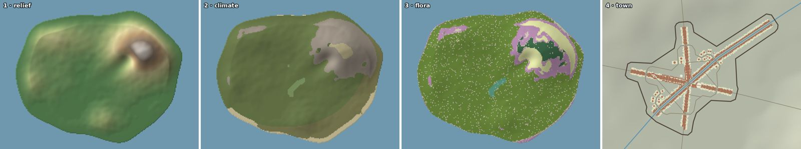
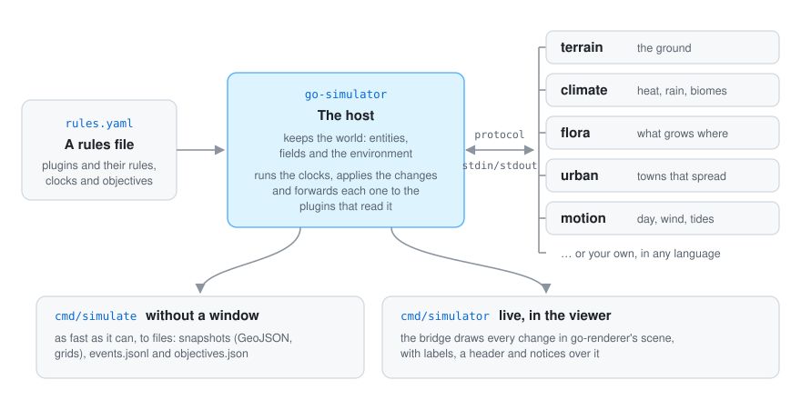

<div align="center">

# Go simulator

**Simulations for [go-renderer](https://github.com/akrck02/go-renderer) scenes, built from plugins.**
The simulators are separate programs, in any language, that the host starts at runtime. A rules
file says which to use and what the run must reach; the world they share is plain data.

[](go.mod)


</div>

> **Note:** this project was written with an AI assistant and is pending thorough review. See the [AI disclosure](#-ai-disclosure).

## 🤖 AI disclosure

I write most of my code by hand, so I want to be clear about this project: **it was written by an
AI assistant (Claude, by Anthropic) under my direction.** I decided what to build and how it should
behave; the code, the tests and the documentation were written by the AI. Every commit made this
way carries a `Co-Authored-By: Claude` line (all of them).

**Status: pending thorough review.** The code compiles and its tests pass, but I have not yet
reviewed it line by line. Treat it as a working draft, not as code I vouch for.

---

<p align="center">
<picture>
  <source media="(prefers-color-scheme: dark)" srcset="docs/images/hero-dark.png">
  
</picture>
</p>

<p align="center"><sub>A made-up plugin sails three boats round go-renderer's sample island. Everything written over the scene comes from the entities' properties and the plugin's events.</sub></p>

## ✨ What it looks like

<table>
<tr>
<th width="33%">Labels over the scene</th>
<th width="33%">A header and notices</th>
<th width="33%">The map</th>
</tr>
<tr>
<td>
<picture>
  <source media="(prefers-color-scheme: dark)" srcset="docs/images/labels-dark.png">
  
</picture>
</td>
<td>
<picture>
  <source media="(prefers-color-scheme: dark)" srcset="docs/images/overlay-dark.png">
  
</picture>
</td>
<td>
<picture>
  <source media="(prefers-color-scheme: dark)" srcset="docs/images/map-dark.png">
  
</picture>
</td>
</tr>
<tr>
<td>An entity's <code>label</code>, <code>icon</code> and <code>badge</code> float above it, at the same size at any zoom.</td>
<td>Entities with <code>pinned</code> form the header; events with a <code>notice</code> show under it, then fade.</td>
<td>The same overlay on the viewer's map, by day or by night.</td>
</tr>
<tr>
<td colspan="3" align="center">

<br>Four plugins taking turns on one made-up island, run without a window: relief, climate, flora and a town.
</td>
</tr>
</table>

## 🚀 Quick start

```bash
go run ./cmd/simulator -rules rules.yaml scene.glb          # live, in the viewer
go run ./cmd/simulate -rules rules.yaml -output results/     # without a window, to files
```

```yaml
plugins:
  - {name: motion, command: [go-simulator-motion]}
stages:
  - name: weather
    clock: realtime
    rules:
      - {rule: day_cycle, with: {seconds_per_day: 120}, toggle_key: T}
```

A plugin answers with changes; in Go it fits in a page:

```go
func (rule *lighthouse) Step(context *plugin.Context) error {
	rule.angle += rule.speed * context.Step
	turned := spatial.RotationY(rule.angle)
	context.Modify(&world.Entity{Identifier: "lighthouse-beam", Transform: &turned})
	return nil
}
```

During development the renderer and the scene builder are used from the folders next to this one
(`replace` in `go.mod`). Building the viewer needs GEOS (`pkg-config geos`) for the scene builder.
[More on running →](docs/running.md)

## 🔍 How it works

<p align="center">
  
</p>

go-renderer draws a scene and knows nothing about simulations; go-simulator holds the world model,
the change protocol, the host engine, rules files and the renderer bridge; the plugins (terrain,
climate, flora, urban, motion…) live in their own repositories. Plugins never touch the renderer:
they read the world and answer with **changes**; the host applies them, forwards them to the
plugins that read that part of the world, and the bridge shows them in the scene.
[More on the architecture →](docs/architecture.md)

## 📚 Documentation

| | |
|---|---|
| [The quest](docs/quest.md) | Bring a harbour to life in 6 levels, writing a plugin of your own. |
| [Architecture](docs/architecture.md) | The world, the seven changes, one step from start to end, interests, events and clocks. |
| [Rules files](docs/rules-files.md) | Every key, with includes, anchors and objectives. |
| [Running](docs/running.md) | `simulate`, `simulator`, the files they write and the bridge. |
| [Labels, header and notices](docs/overlay.md) | The words the live viewer writes over the scene. |
| [Writing plugins](docs/writing-plugins.md) | The Go toolkit and other languages. |
| [Vocabulary and conditions](docs/vocabulary.md) | Shared names, units and the condition language. |
| [Protocol](docs/protocol.md) | Frames, messages and the JSON of every change. |
