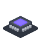

# Welcome to Go Simulator 👋

**Go Simulator brings scenes to life with simulations**: the sun crossing the sky, boats sailing, towns growing for a century, forests spreading over an island.

Each kind of simulation is a separate small program, a **plugin**: terrain, climate, flora, towns, motion, or one you write. A **rules file** (plain text) says which plugins to use and with which numbers; Go Simulator runs them together on one shared world, and shows it live in Go Renderer's viewer or writes the results to files.

## Is it for me?

- ✅ You want to **watch** a place change: weather, growth, movement.
- ✅ You want to **combine** simulations without them knowing each other.
- ✅ You write Go (or any language) and want to **write a simulation** of your own.

## Where to start

Pick the line that sounds like you.

| If you… | Read | Time |
|---|---|---|
| are **new** and want to see a simulation running | 🏴‍☠️ [The quest](2-the-quest.md): a harbour that lives, in 6 levels | 60 min |
| want to understand **how the pieces fit** | [How it fits together](3-how-it-fits-together.md) | 15 min |
| want to **set up a simulation** with existing plugins | [Rules files](4-guides/1-rules-files.md) and [Running](4-guides/2-running.md) | — |
| want to **write a plugin** | [Writing plugins](4-guides/4-writing-plugins.md) | — |
| are **looking up** a name or a message | [The reference](5-reference/1-vocabulary-and-conditions.md) | — |

## All the pages, in reading order

The menu on the left (or the files in `docs/`) follows this order.

**Start**

- [Overview](1-overview.md): this page
- [The quest](2-the-quest.md): six levels and a plugin of your own
- [How it fits together](3-how-it-fits-together.md)

**Guides**

- [Rules files](4-guides/1-rules-files.md)
- [Running](4-guides/2-running.md)
- [Labels, header and notices](4-guides/3-labels-header-and-notices.md)
- [Writing plugins](4-guides/4-writing-plugins.md)

**Reference**

- [Vocabulary and conditions](5-reference/1-vocabulary-and-conditions.md)
- [Protocol](5-reference/2-protocol.md)

**Proposals**

- [Output contracts](6-proposals/1-output-contracts.md)

## 🚧 Not done yet

- The bridge does not draw fields yet: a scene builder can turn them into terrain or vegetation.
- Ground shapes take their height from the scene's walkable ground; the first time, the renderer
  builds its ground index, which can take a few seconds on a large terrain.
- Removed meshes leave the scene, but Go Renderer has no call yet to free their GPU memory.
- Plugins resolve Go Renderer through this module's requirements, so a plugin's `go.mod` needs the
  same `replace` during development.

## Words you will meet

| Word | What it means |
|---|---|
| Terminal | The window where you type commands: *Terminal* on macOS and Linux, *PowerShell* on Windows. |
| Repository | A project's folder of files, kept on GitHub. `git clone <address>` copies it to your computer. |
| Scene | Everything a 3D picture holds: ground, houses, trees, the sea, the sky and the sun. |
| Plugin | A small program that adds one ability to another: here, one kind of simulation each. |
| Rules file | A text file (YAML) that says which plugins to use, with which numbers, for how long: no programming needed. |
| Field | A grid of numbers laid over the world: the height of every spot, its temperature, its rain. |
| Quest | The tutorial of these docs: short levels, each ending with something that works and an achievement. |

## The family

Go Simulator is one of a family of small projects that work together:

| Project | What it does |
|---|---|
| [Go Renderer](https://github.com/akrck02/go-renderer) | draws 3D scenes and flat interfaces |
| [Go UI](https://github.com/akrck02/go-ui) | buttons, panels and whole applications |
| [Go UI for Android](https://github.com/akrck02/go-ui-android) | Android apps that look like Android's own |
| [Go Sound](https://github.com/akrck02/go-sound) | sound and music |
| [Go Scene Builder](https://github.com/akrck02/go-scene-builder) | 3D scenes from a flat map |
| **Go Simulator** (this one) | simulations that change a scene |
| [Go Terrain Simulator](https://github.com/akrck02/go-simulator-terrain) | ground shaped by rivers |
| [Go Climate Simulator](https://github.com/akrck02/go-simulator-climate) | weather and biomes |
| [Go Flora Simulator](https://github.com/akrck02/go-simulator-flora) | forests that grow |
| [Go Urban Simulator](https://github.com/akrck02/go-simulator-urban) | towns that grow |
| [Go Motion Simulator](https://github.com/akrck02/go-simulator-motion) | a scene that moves |
| [Go for 3DS](https://github.com/akrck02/go-3ds) | Go on the Nintendo 3DS |

> ⚠️ All of them are **educational experiments**, written with an AI assistant and pending review by their author: good for learning and playing, not for production.
