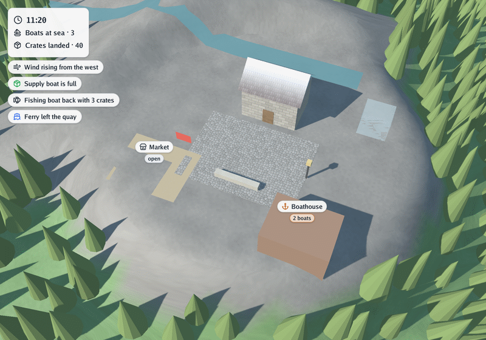
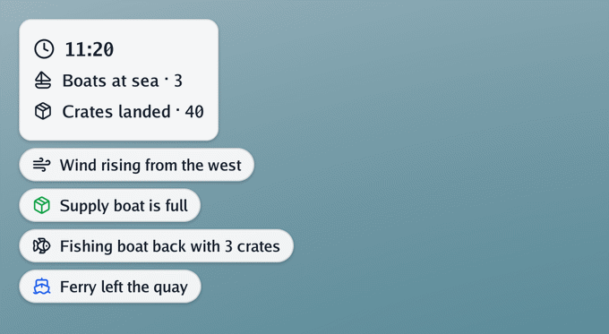
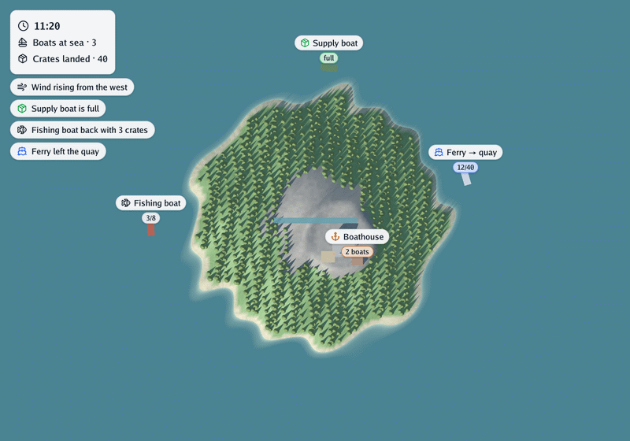

# 🏷️ Labels, header and notices

Besides the scene, the live viewer (`cmd/simulator`) writes a few words over it: what a boat
carries, what time it is in the simulation, what just happened. Plugins do not draw any of it.
They set a few [overlay properties](../5-reference/1-vocabulary-and-conditions.md#shared-names) on their entities and a `notice`
on their events, and the [bridge](2-running.md#the-bridge) turns them into labels, a header and
notices.

<p align="center">
<picture>
  <source media="(prefers-color-scheme: dark)" srcset="../images/hero-dark.png">
  
</picture>
</p>

*The pictures on this page are captures of the viewer (`-capture`), by day and with `-night`,
of go-renderer's made-up sample island and a small made-up plugin that sails three boats round it.*

## Labels

<p align="center">
<picture>
  <source media="(prefers-color-scheme: dark)" srcset="../images/labels-dark.png">
  
</picture>
</p>

An entity with a `label`, an `icon` or a `badge` gets a light pill above it, with the badge in a
smaller pill underneath. Labels keep their size on screen at any zoom, follow their entity as it
moves and disappear when it is off screen, hidden or removed. When two would overlap, the one
nearer the camera is shown.

```json
{"op": "add", "entity": {"id": "ferry", "kind": "boat", "shape": {"primitive": "box", "size": [4, 2, 10]},
  "properties": {"label": "Ferry → quay", "icon": "ship", "badge": "12/40", "label_color": "#2563eb"}}}
```

| Property | Value | Shown as |
|---|---|---|
| `label` | text | a short text in a light pill above the entity |
| `icon` | text: a [Lucide](https://lucide.dev/icons) icon name | an icon before the label, or alone in a circle |
| `badge` | text (or a number) | a very short text in a small pill under the label: `7/10` |
| `label_color` | `"#rrggbb"` | the colour of the icon and the badge; the text stays dark so it always reads well |

How high a label floats:

| Shape | Label anchored at |
|---|---|
| `box` | the top of the box |
| a mesh of the scene | its highest point |
| outline | over the middle of the outline, at its `height` (just over the ground when flat) |
| line | over its middle point, at its `height` |
| none | the entity's position |

## The header and notices

<p align="center">
<picture>
  <source media="(prefers-color-scheme: dark)" srcset="../images/overlay-dark.png">
  
</picture>
</p>

- **The header**: entities with `pinned` (a number) are listed in a card at the top-left corner,
  by that number (1 first) instead of above the entity; a badge follows the text after a dot. Such
  entities need no shape. A clock and a few counters fit well there.
- **Notices**: events with a `notice` appear under the header, newest first, for about six
  seconds of the viewer's time, then fade. An event can add an `icon` and a `label_color`.

```json
{"op": "add", "entity": {"id": "harbour-clock", "properties": {"label": "08:25", "icon": "clock", "pinned": 1}}}
{"op": "emit", "event": {"name": "arrivals", "data": {"notice": "Boat 4 moored at the north quay", "icon": "anchor"}}}
```

## On the map

<p align="center">
<picture>
  <source media="(prefers-color-scheme: dark)" srcset="../images/map-dark.png">
  
</picture>
</p>

The overlay is drawn in every view of the viewer: orbiting, walking, and the map (`-map`, or `M`).

## Good to know

- Property-only changes (a `modify` with only `properties`) update the label at once; setting a
  property to `null` takes it away.
- Captures (`-capture`) include the overlay.
- `simulate` has no window and ignores the overlay, but its snapshots keep the properties.
- Models should not read the overlay properties: they are for whoever watches the run.
