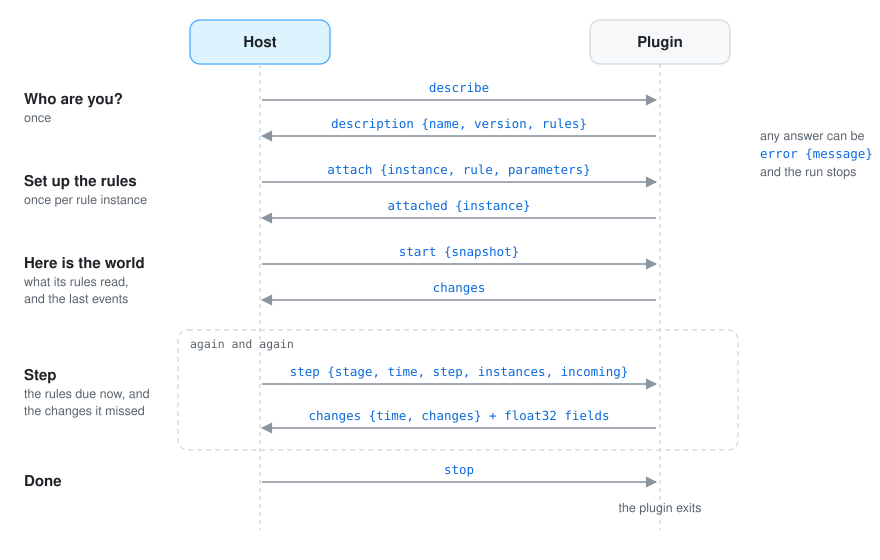

# 📡 Protocol

You only need this page to write a plugin in a language other than Go (the Go toolkit does all of
this for you), or to understand what travels between the host and its plugins.

The idea is simple: the host starts the plugin as a program and they talk through the plugin's
standard input and output, one message at a time. The plugin's standard error is free for its own
logs. Any language that can read and write bytes can be a plugin. Protocol version: 2 (the host still
accepts plugins of version 1; see [contracts](#contracts)).

## Frames

Every message is a *frame*: a length, so the reader knows how much to read, a small JSON header,
and then any binary data. Binary data is only used for the numbers of fields, so that sending a
grid of a million cells does not mean writing a million numbers as text.

```
┌──────────────┬──────────────────────────────────────────────┬──────────────────────────┐
│ 4 bytes      │ header: JSON of that length                  │ attachments, one after   │
│ length (LE)  │ {"kind", "body", "attachments": [lengths]}   │ another (raw bytes)      │
└──────────────┴──────────────────────────────────────────────┴──────────────────────────┘
```

- The length is a little-endian unsigned 32-bit integer; headers above 64 MiB are refused (a
  plugin that prints to its standard output by mistake is caught this way).
- `body` is the message's JSON; `attachments` lists the byte length of every attachment.
- Field values travel as attachments of little-endian float32: one attachment per `set_field`
  change, in the order those changes appear in the message (in a change set, a snapshot or the
  incoming changes of a step). The JSON of a field patch has no values.

## Conversation

A conversation always follows the same order: the host asks who the plugin is, tells it which rules
to set up, gives it the world, and then asks it to step again and again until it says stop.

<p align="center">
  
</p>

| Host sends | Body | Plugin answers |
|---|---|---|
| `describe` | — | `description`: `{protocol, name, version, summary, rules: [{name, summary, parameters, reads, writes, publishes, expects}]}` |
| `attach` | `{instance, rule, parameters}` | `attached`: `{instance}` |
| `start` | `{snapshot: change set}` | `changes`: a change set |
| `step` | `{stage, time, step, instances, incoming: [changes]}` | `changes`: a change set |
| `stop` | — | exits |

Any answer can instead be `error` with `{message}`; the host stops the simulation with it.

- `attach` comes once per rule instance; the same rule can be attached several times.
- `start`'s snapshot holds the part of the world the plugin's rules read, as `add`,
  `set_field` and `set_environment` changes, plus the last event of every name it reads.
- `step` gives the stage time after the step (`time`), how much time it covers (`step`), the
  instances to run in this order, and the changes other plugins made since the last message
  that the plugin reads.

A rule's `parameters` are described as `{name, type, default, summary}` with type `number`,
`boolean`, `text`, `vector`, `list` or `map`.

## Contracts

Plugins never talk to each other, so they agree on names: one publishes `elevation`, another asks
for `elevation`. Since version 2 a rule says what it publishes and what it needs, with units, and
the host compares the rules a rules file attaches **before the first step**. The names are free
text: nothing has to be registered anywhere.

```json
"publishes": [
  {"name": "elevation", "what": "field", "unit": "m", "summary": "height of the ground"},
  {"name": "biome", "what": "field", "unit": "index", "names": "biomes"},
  {"name": "biomes", "what": "event", "properties": [{"name": "names"}]},
  {"name": "river", "what": "kind", "properties": [{"name": "width", "unit": "world"}]}
],
"expects": [{"name": "elevation", "what": "field", "unit": "m", "required": true}]
```

- `what` is `field`, `kind`, `event` or `environment`.
- `unit` is one of `m`, `km`, `m²`, `km²`, `mm`, `°C`, `m/m`, `1` (a share or a plain number),
  `index` (a category; `names` is the event that names the values), `world` (the scene's world
  units), `s` or `year`. Fields need one; properties that are not quantities (a name, a class)
  leave it out. Units are compared as text and never converted.
- `properties` are the properties of a kind's entities or the members of an event's data.
- `expects` says what the rule needs from what it reads; `reads` still decides what the host
  sends it. `required` means the rule cannot work without it.

The host refuses to start when:

- the same field, property or event member is published in two units;
- a rule expects a unit other than the one published;
- a rule requires something no rule publishes and the initial world does not have;
- a description is malformed (no name, an unknown `what` or unit, a field without a unit).

It warns, and starts, when a rule reads something only a later rule of the rules file publishes
(its first step will not have it) and when a field of categories has no event naming them.

A rule that lists names in `writes` but no `publishes`, or any rule of a version 1 plugin, is
not checked: the host says once which plugins those are, and counts their `writes` as published,
in no known unit, so what they write is not reported missing.

## Change sets

```json
{"origin": "urban", "stage": "town", "time": 42, "changes": [ … ]}
```

The host fills `origin` and `stage`; a plugin sends `time` and `changes`.

## Changes

```json
{"op": "add", "entity": {"id": "house-7", "kind": "building",
  "shape": {"outline": [[0, 0], [0.01, 0], [0.01, 0.01], [0, 0.01]], "height": 0.008, "batch": "buildings",
            "color": [0.48, 0.18, 0.09, 1]},
  "properties": {"use": "shop", "floors": 2}}}
{"op": "remove", "id": "house-7"}
{"op": "modify", "entity": {"id": "house-7", "properties": {"floors": 3, "use": null}}}
{"op": "set_field", "field": {"name": "elevation", "columns": 240, "rows": 180,
  "extent": {"minimum_x": -6, "maximum_x": 6, "minimum_z": -4.5, "maximum_z": 4.5}}}
{"op": "set_field", "field": {"name": "elevation", "region": {"column": 10, "row": 4, "columns": 2, "rows": 2}}}
{"op": "set_environment", "environment": {"wind": {"direction": [1, 0, 0], "strength": 0.4}}}
{"op": "emit", "event": {"name": "indicators", "data": {"year": 42, "inhabitants": 3100}}}
{"op": "clear_area", "area": {"outlines": [[[0, 0], [1, 0], [1, 1]]], "keep": [], "nodes": ["forest"]}}
```

**Entity:** `id`, `kind`, `parent`, `transform` (16 numbers, column-major, as go-renderer),
`shape`, `properties`. In a `modify`, set members replace; properties merge, and a null removes one.

**Shape:** `mesh`, `primitive` (`box`) with `size` and `offset`, `outline`, `line` with `width`,
`height`, `lift`, `batch`, `color` (linear RGBA), `hidden`.

**Field patch:** `name`; `columns`, `rows` and `extent` only to create the field; `region` (a
rectangle of cells) to set part of it; without a region the values cover the whole field. Values,
row by row from the smallest z, arrive as the attachment.

**Environment:** `sun_direction`, `celestial_pole`, `cloud_offset` (vectors), `wind`
(`{direction, strength}`), `tide_angle` (radians), `snow` (`{level, blend}`), `foliage_tint`
(linear RGBA, the alpha is the amount). Every set member replaces the current one.

## A whole exchange

```
host  → describe
plugin→ description {"protocol": 1, "name": "coast", "version": "0.1.0", "rules": [{"name": "turn_beam", "reads": {"kinds": ["beam"]}}]}
host  → attach {"instance": "night/turn_beam", "rule": "turn_beam", "parameters": {}}
plugin→ attached {"instance": "night/turn_beam"}
host  → start {"snapshot": {"time": 0, "changes": [{"op": "add", "entity": {"id": "lighthouse-beam", "kind": "beam"}}]}}
plugin→ changes {"time": 0, "changes": []}
host  → step {"stage": "night", "time": 0.016, "step": 0.016, "instances": ["night/turn_beam"]}
plugin→ changes {"time": 0.016, "changes": [{"op": "modify", "entity": {"id": "lighthouse-beam", "transform": [ … ]}}]}
…
host  → stop
```
