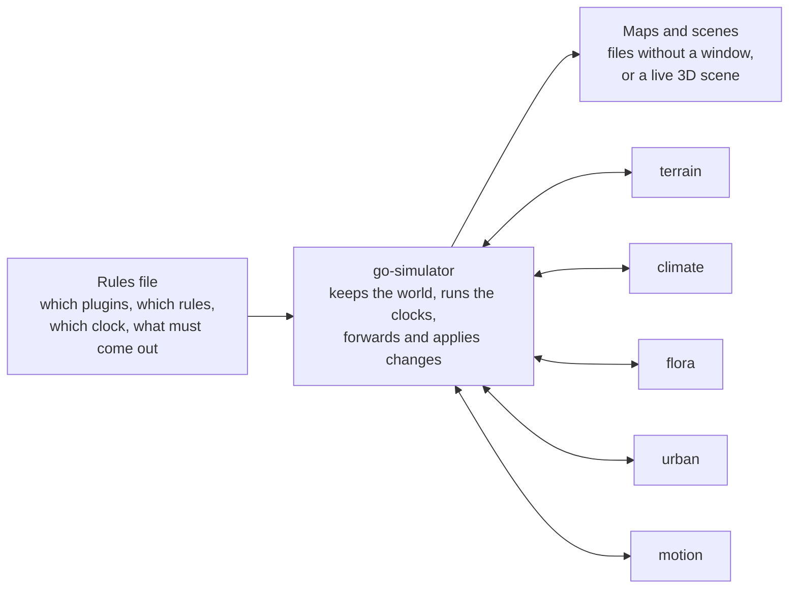
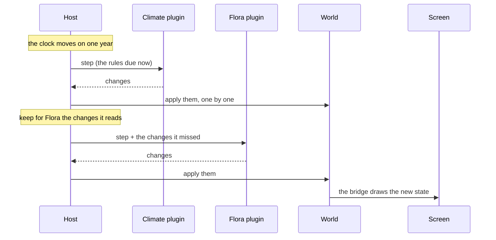

# How it fits together

## A theatre with stagehands

Picture a theatre. The **stage** shows whatever is on it and does not care what the play is about:
that is [go-renderer](https://github.com/akrck02/go-renderer). The **stagehand** moves things between scenes: that is
go-simulator, the host. And the **script** for each kind of change lives with specialists,
the **plugins**: one knows how rain falls, another how forests grow, another how towns spread.



A plugin never draws anything and never talks to another plugin. It reads the part of the world it
cares about and answers with **changes**. That one rule is what makes the whole thing work: plugins
can be written separately, in any language, and combined freely.

## What the world is made of

The world is plain data, with nothing about how it looks on screen. It holds three kinds of things,
on a ground plane where x points east, z points south and y points up:

- **Entities** are things that exist: a house, a street, a boat, a plot of land. Each has an id that
  never changes, a kind (`building`, `street`…), maybe a parent it moves with, a position, a shape
  and free properties such as `floors: 2` or `use: shop`.
- **Fields** are grids of numbers laid over the ground: the height of the land, the temperature,
  what grows where. They travel as raw numbers, so a million cells is cheap.
- **The environment** is what surrounds everything: where the sun is, the wind, the clouds, the
  tide, how low the snow comes, the colour of the leaves.

An entity's **shape** decides how it will be drawn:

| Shape | Looks like |
|---|---|
| `mesh` | something the scene already has, by name |
| `primitive: box` | a box |
| `outline` | a flat patch of ground (a plot), or with a `height`, a building |
| `line` + `width` | a strip on the ground (a street), or with a `height`, a wall |

Outlines and lines hug the terrain. Shapes that share a `batch` are drawn as a single mesh, which is
why a town of thousands of houses costs only a handful of draw calls.

## Seven ways to change the world

The world never changes behind anyone's back: every change is one of seven kinds. Because changes
are just data, they can be saved, forwarded to other plugins and replayed later.

| Change | What it means |
|---|---|
| `add` | Something new appears |
| `remove` | Something goes away, with everything attached to it |
| `modify` | Something changes; properties are merged, and setting one to null removes it |
| `set_field` | A grid is created, or some of its cells change |
| `set_environment` | The sun, wind, tide… change |
| `emit` | "Something happened worth telling" (an event); the world itself does not change |
| `clear_area` | The simulation takes over part of the drawn scene and clears it (a forest where a town grows) |

## One step, from start to finish

Here is what happens in one year of a simulation with a climate plugin and a flora plugin:



1. The stage's clock moves forward: one step, or the seconds that passed on screen.
2. The host gathers the rules that are due, in the order the rules file lists them. Rules of the
   same plugin that come one after another travel together in one request.
3. The plugin runs them on its own copy of the world. Each rule already sees what the previous one
   changed. It answers with all the changes.
4. The host applies them to the world, in order.
5. For each change, it notes which other plugins care about it, and keeps it for them.
6. When it is the next plugin's turn, those changes travel with its request, so its copy of the
   world is up to date before its rules run.
7. With a window, the bridge turns the changes into scene updates and the renderer draws them.
   Without one, the host saves snapshots at the times you asked for.

**Starting** works the same way. Each plugin receives a snapshot of the part of the world it reads,
plus the latest event of each name it listens to. Plugins start in the order of the rules file, so
the ones further down already find what the earlier ones published: the climate's fields, and the
event that names its biomes, are there before the flora takes its first step.

## Who hears about what

Every rule says what it **reads** (its interest) and what it **writes**. The host only sends each
plugin what it asked for: the climate never hears about houses, and the town never hears about the
temperature unless it asks.

```yaml
reads: {kinds: [building, street], properties: [anchor], fields: [elevation], environment: true, events: [biomes]}
```

An entity is included when its kind is listed or it has one of the listed properties.
`everything: true` reads it all, and `events: ["*"]` listens to every event.

## Events

Some things are news, not state. The climate wants to say "value 3 of my biome field means
*forest*"; the town wants to say "this year I have 3,100 people". That is what `emit` is for. Events
reach the plugins that listen to their name (in `context.Events`), they are saved to a log, and
objectives can check them.

## Clocks

Rules live in **stages**, and each stage has its own clock. All stages share one world, so the
clouds can drift in real time while a town grows a year at a time.

- **Real time** moves with the seconds on screen, faster or slower as you like.
- **Stepped** moves one step at a time, from `from` to `to`: as fast as possible without a window,
  or one step every `pace` seconds while you watch.

A rule can run at every step, every so often (`every: 5`) or just once (`at: 10`), and can be
switched on and off with a key.

```
step          1   2   3   4   5   6   7   8   9   10
every step    ●   ●   ●   ●   ●   ●   ●   ●   ●   ●
every: 5      ●                   ●
at: 3                 ●
```

## Generic simulators, concrete results

None of the simulators knows the world it runs in. Everything specific comes in as data, kept in
three layers:

| Layer | Holds | Example |
|---|---|---|
| **Scenario** | the numbers and places of one world, and what must come out | the population curve, where the gate is |
| **Vocabulary** | the names plugins share, with their units | `elevation` in metres, kind `building` |
| **Mechanism** | each simulator's code | published models of climate, forest succession, town growth |

Two tools tie a generic simulator to a concrete result. **Anchors** fix places the story says are
there, and the plugins build around them. **Objectives** state what the run must reach ("walled by
year 60", "about 6,000 people at the end"); a run that misses one fails and says which. With a fixed
seed, a run that meets its objectives gives the same result every time.

## The packages

| Package | Role |
|---|---|
| `world` | The world, the changes, interests and the shared vocabulary |
| `protocol` | The messages between host and plugins |
| `plugin` | The toolkit for writing plugins in Go |
| `host` | Starts plugins, adds anchors, runs the stages and checks objectives |
| `configuration` | Reads and checks rules files |
| `conditions` | The little "when does this apply" language |
| `spatial` | Small 3D maths for plugins, without the renderer |
| `snapshot` | Saves the world to files (GeoJSON, grids) and reads GeoJSON |
| `bridge` | Builds the world from a scene and draws every change |
| `scenebuilder` | Lets the bridge draw with go-scene-builder's style rules |
