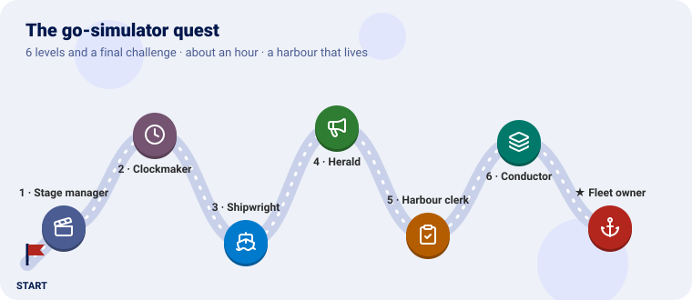
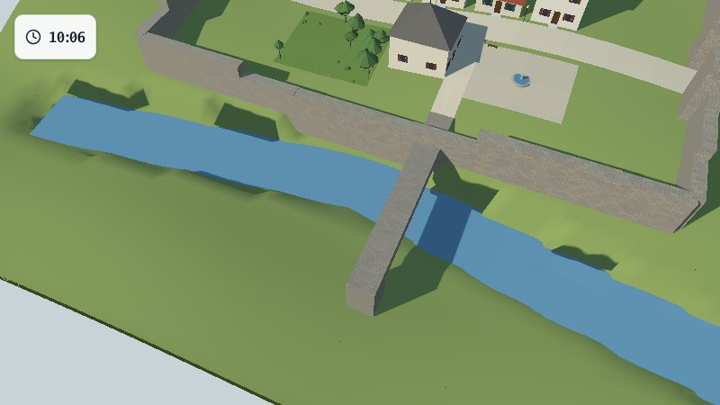
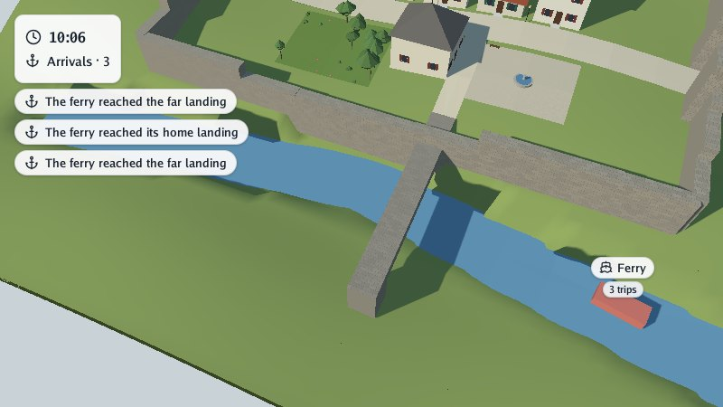
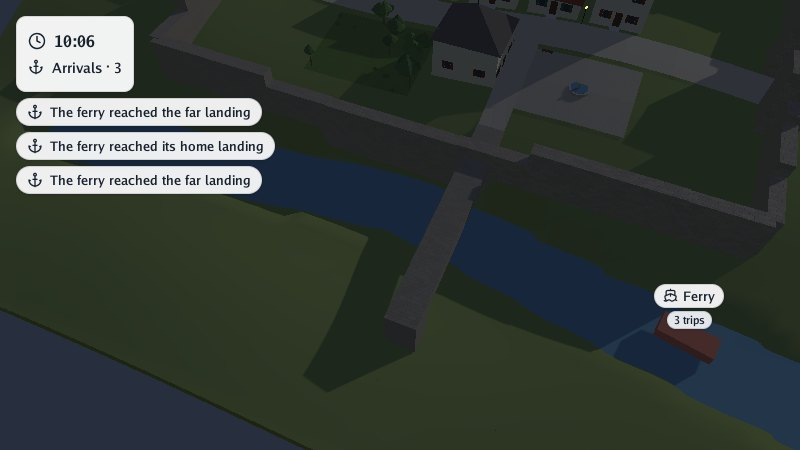
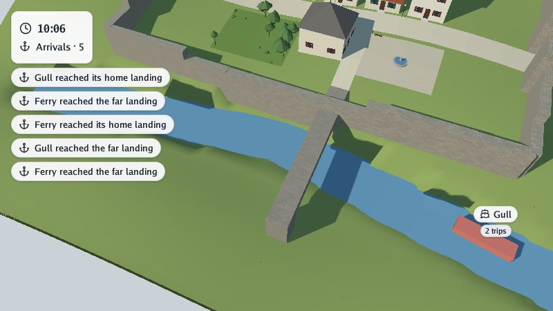
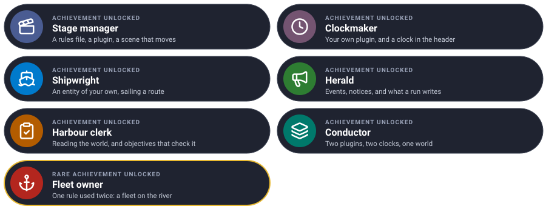

# The go-simulator quest

Bring a scene to life, one level at a time. Each level teaches one piece of go-simulator and ends
with something new happening in the scene.



We will make a **harbour that lives**: the weather moving over a village, a clock in the corner of
the screen, a ferry sailing up and down the river, notices when it lands, a clerk counting its
trips, and in the end a whole fleet. You write a **plugin** of your own, in Go.

---

Every level has the same shape: **the idea** (explained with something from everyday life), **the
code**, a **checkpoint** to know it works, and an optional **bonus**.

---

## Before you start

You need Go 1.25 and GEOS (`sudo apt install libgeos-dev`, `brew install geos`), and a scene. We use
the village from [go-scene-builder's quest](https://github.com/akrck02/go-scene-builder/blob/master/docs/quest.md):
any `.glb` works, but the coordinates below fit that village (scene units are kilometres; the river
runs east to west about 25 metres south of the centre).

Clone the projects side by side:

```sh
git clone https://github.com/akrck02/go-renderer
git clone https://github.com/akrck02/go-scene-builder
git clone https://github.com/akrck02/go-simulator
git clone https://github.com/akrck02/go-simulator-motion
mkdir quest && cd quest
cp ../village/village.glb .      # or any scene
```

Two commands, which you will use all along:

```sh
# live: the scene in the viewer, with the simulation running
go run ../go-simulator/cmd/simulator -rules rules.yaml village.glb
# without a window: as fast as it can, to files
go run ../go-simulator/cmd/simulate -rules rules.yaml -scene village.glb -output results/
```

The pictures were taken with `-advance 42 -look-at 0,0.025 -zoom 0.5 -capture shot.png`.

This is where everything will live by the end:

```
quest/
├── village.glb
├── rules.yaml          ← every level
└── harbour/            ← your plugin, from level 2
    ├── go.mod
    ├── main.go
    ├── clock.go        ← level 2
    ├── ferry.go        ← level 3
    └── quay.go         ← level 5
```

---

## Level 1 · The Stage manager

| Mission | Pieces | Time |
|---|---|---|
| Wind, clouds and the day passing over the village | a rules file, a plugin, a real-time stage | 5 min |

#### The idea

A theatre's **stage manager** does not act: they follow a **script** that says who comes on, when,
and what they do. go-simulator is the stage manager, the **rules file** is the script, and the
**plugins** are the actors: separate programs, each knowing how to do a few things (*rules*).

The motion plugin knows how to turn the sun, blow the wind and drift the clouds.

#### Build it

`rules.yaml`:

```yaml
plugins:
  - name: motion
    command: [go, run, .]
    directory: ../go-simulator-motion

stages:
  - name: weather
    clock: realtime
    rules:
      - {rule: day_cycle, with: {seconds_per_day: 120}, toggle_key: T}
      - {rule: gusts, with: {variation: 0.5}}
      - rule: cloud_drift
```

A **stage** is a group of rules that share a clock; `realtime` follows the seconds you watch.

#### Checkpoint

Run it live. The trees sway in gusts, and the sun crosses the sky in two minutes: shadows turn, and
night falls. **T** stops and starts the day; **P** pauses; **,** and **.** slow time down or speed
it up.

#### Bonus (optional): faster days

<details>
<summary>🔓 Show the solution</summary>

`seconds_per_day: 30`, or press **.** twice in the viewer.

</details>


Learn more: [Rules files](rules-files.md) · [Running](running.md)

---

## Level 2 · The Clockmaker

| Mission | Pieces | Time |
|---|---|---|
| A plugin of your own, with a clock in the corner | `plugin.Plugin`, a rule, `Start`, `Step`, a stepped clock | 10 min |

#### The idea

A plugin is an **actor** with a few tricks (its rules). The stage manager calls it on stage at
every step and asks: *what changes now?* The actor never touches the scenery itself: it answers
with **changes** ("this thing moved", "that label now says 08:30"), and the host applies them.

Anything in the world is an **entity**: an id, a kind and free properties. An entity with the
property `pinned` is shown in the header in the corner, so a clock needs no shape at all.

#### Build it

A module for the plugin, `harbour/go.mod`:

```
module example.com/harbour

go 1.25.6

require github.com/akrck02/go-simulator v0.0.0

replace (
	github.com/akrck02/go-simulator => ../../go-simulator
	github.com/akrck02/go-renderer => ../../go-renderer
	github.com/akrck02/go-scene-builder => ../../go-scene-builder
)
```

`harbour/clock.go`, the rule:

```go
package main

import (
	"fmt"
	"math"

	"github.com/akrck02/go-simulator/plugin"
	"github.com/akrck02/go-simulator/protocol"
	"github.com/akrck02/go-simulator/world"
)

// clock writes the time of day in the header's first line. The stage's clock counts hours.
type clock struct{ start float64 }

var clockRule = plugin.Definition{
	Description: protocol.RuleDescription{
		Name:       "clock",
		Summary:    "Shows the time of day in the header.",
		Parameters: []protocol.ParameterDescription{{Name: "start", Type: "number", Default: 8, Summary: "hour the day starts at"}},
		Writes:     []string{"clock"},
		Publishes:  []protocol.OutputDescription{plugin.Kind("clock", "the harbour's clock, pinned to the header")},
	},
	New: func(parameters plugin.Parameters) (plugin.Rule, error) {
		return &clock{start: parameters.Number("start", 8)}, nil
	},
}

// Start adds the clock once: an entity with no shape, pinned first in the header.
func (rule *clock) Start(context *plugin.Context) error {
	context.Add(&world.Entity{Identifier: "harbour-clock", Kind: "clock",
		Properties: map[string]any{"label": rule.time(context.Time), "icon": "clock", "pinned": 1}})
	return nil
}

// Step writes the new time on it.
func (rule *clock) Step(context *plugin.Context) error {
	context.Modify(&world.Entity{Identifier: "harbour-clock", Properties: map[string]any{"label": rule.time(context.Time)}})
	return nil
}

// time turns the stage's hours into "08:30".
func (rule *clock) time(hours float64) string {
	total := math.Mod(rule.start+hours, 24)
	return fmt.Sprintf("%02d:%02d", int(total), int(math.Mod(total*60, 60)))
}
```

`harbour/main.go`, the plugin (for now, `Rules: []plugin.Definition{clockRule}`):

```go
// Command harbour is a simulator plugin: a clock in the corner, a ferry that crosses the river and
// a quay that counts its arrivals.
package main

import (
	"log"

	"github.com/akrck02/go-simulator/plugin"
)

func main() {
	log.SetFlags(0) // logs go to standard error: standard output carries the protocol
	harbour := &plugin.Plugin{Name: "harbour", Version: "0.1.0", Rules: []plugin.Definition{clockRule, ferryRule, quayRule}}
	if err := harbour.Serve(); err != nil {
		log.Fatal(err)
	}
}
```

The rules file gets a second plugin and a **stepped** stage, whose clock counts hours, one step of
three minutes every tenth of a real second:

```yaml
plugins:
  - name: harbour
    command: [go, run, .]
    directory: harbour

stages:
  - name: day
    clock: {unit: hour, from: 0, to: 12, step: 0.05, pace: 0.1}
    rules:
      - {rule: clock, with: {start: 8}}
```

(Keep the weather stage too, if you like: both run together.) Then, once: `cd harbour && go mod tidy && cd ..`.

#### Checkpoint

Live, a card in the top-left corner shows the time, from 08:00 on, three minutes every tenth of a
second. Without a window, `simulate` prints every step, `day 0.05 … day 12`, and ends.



#### Bonus (optional): a.m. and p.m.

<details>
<summary>🔓 Show the solution</summary>

In `time`, compute `hour := int(total)`, then `suffix := "am"`; if `hour >= 12`, `suffix = "pm"`
and `hour -= 12`; if `hour == 0`, `hour = 12`. Write `fmt.Sprintf("%d:%02d %s", hour, minutes, suffix)`.

</details>


Learn more: [Writing plugins](writing-plugins.md)

---

## Level 3 · The Shipwright

| Mission | Pieces | Time |
|---|---|---|
| A ferry that sails up and down the river | an entity with a shape, its transform, parameters | 12 min |

#### The idea

A **shipwright** builds the boat once, then it sails. In `Start` the rule **adds** an entity with a
shape (a red box, standing in for a boat); at every `Step` it **modifies** only what changed: its
place (`Transform`) and its badge. The rest stays as it was.

Where it sails comes from the rules file, as **parameters**: the same rule can sail any river.

#### Build it

`harbour/ferry.go`:

```go
package main

import (
	"fmt"
	"math"

	"github.com/akrck02/go-simulator/plugin"
	"github.com/akrck02/go-simulator/protocol"
	"github.com/akrck02/go-simulator/spatial"
	"github.com/akrck02/go-simulator/world"
)

// ferry crosses back and forth along a route, and says when it arrives at either end.
type ferry struct {
	route    [][2]float64 // points (x, z) in the scene's units
	speed    float64      // scene units an hour
	distance float64      // how far along the route it is, forth and back
	trips    int
}

var ferryRule = plugin.Definition{
	Description: protocol.RuleDescription{
		Name:    "ferry",
		Summary: "Sails a ferry along a route, back and forth.",
		Parameters: []protocol.ParameterDescription{
			{Name: "route", Type: "list", Summary: "points [x, z] it sails through"},
			{Name: "speed", Type: "number", Default: 0.2, Summary: "scene units an hour"},
		},
		Writes:    []string{"ferry"},
		Publishes: []protocol.OutputDescription{plugin.Kind("ferry", "a boat on a route"), plugin.Event("arrival", "the ferry reached an end of its route")},
	},
	New: func(parameters plugin.Parameters) (plugin.Rule, error) {
		rule := &ferry{speed: parameters.Number("speed", 0.2)}
		points, _ := parameters["route"].([]any)
		for _, point := range points {
			pair := plugin.VectorFrom(point, spatial.Vector{})
			rule.route = append(rule.route, [2]float64{float64(pair[0]), float64(pair[1])})
		}
		if len(rule.route) < 2 {
			return nil, fmt.Errorf("ferry: a route needs two points at least")
		}
		return rule, nil
	},
}

func (rule *ferry) Start(context *plugin.Context) error {
	place := rule.placement()
	context.Add(&world.Entity{Identifier: "ferry", Kind: "ferry", Transform: &place,
		Shape:      &world.Shape{Primitive: "box", Size: spatial.Vector{0.003, 0.0015, 0.007}, Color: &[4]float32{0.7, 0.2, 0.15, 1}},
		Properties: map[string]any{"label": "Ferry", "icon": "ship"}})
	return nil
}

func (rule *ferry) Step(context *plugin.Context) error {
	length := rule.length()
	before := math.Floor(rule.distance / length)
	rule.distance += rule.speed * context.Step
	if math.Floor(rule.distance/length) > before { // passed an end of the route
		rule.trips++
		end := "its home landing"
		if rule.trips%2 == 1 {
			end = "the far landing"
		}
		context.Emit("arrival", map[string]any{"trips": rule.trips, "notice": "The ferry reached " + end, "icon": "anchor"})
	}
	place := rule.placement()
	context.Modify(&world.Entity{Identifier: "ferry", Transform: &place,
		Properties: map[string]any{"badge": fmt.Sprint(rule.trips, " trips"), "trips": rule.trips}})
	return nil
}

// placement is where the ferry is now, turned to face where it goes.
func (rule *ferry) placement() spatial.Matrix {
	length := rule.length()
	along := math.Mod(rule.distance, 2*length)
	if along > length { // on the way back
		along = 2*length - along
	}
	for index := 0; index+1 < len(rule.route); index++ {
		from, to := rule.route[index], rule.route[index+1]
		segment := math.Hypot(to[0]-from[0], to[1]-from[1])
		if along <= segment || index+2 == len(rule.route) {
			share := math.Min(along/segment, 1)
			x, z := from[0]+(to[0]-from[0])*share, from[1]+(to[1]-from[1])*share
			heading := math.Atan2(to[0]-from[0], to[1]-from[1])
			place := spatial.Translation(spatial.Vector{float32(x), 0.0115, float32(z)})
			turned := spatial.RotationY(heading)
			return multiply(place, turned)
		}
		along -= segment
	}
	return spatial.Identity()
}

func (rule *ferry) length() float64 {
	total := 0.0
	for index := 0; index+1 < len(rule.route); index++ {
		total += math.Hypot(rule.route[index+1][0]-rule.route[index][0], rule.route[index+1][1]-rule.route[index][1])
	}
	return total
}

// multiply is first × second, column-major.
func multiply(first, second spatial.Matrix) spatial.Matrix {
	var result spatial.Matrix
	for column := range 4 {
		for row := range 4 {
			for index := range 4 {
				result[column*4+row] += first[index*4+row] * second[column*4+index]
			}
		}
	}
	return result
}
```

Add `ferryRule` to the plugin's rules, and the ferry to the stage:

```yaml
      - rule: ferry
        with: {route: [[-0.05, 0.0295], [0, 0.0215], [0.05, 0.0315]], speed: 0.15}
```

The route is in the scene's units (kilometres), `[x, z]`, with z growing to the south.

#### Checkpoint

A red ferry sails along the river, under the bridge, turns at the end and comes back; its label
says how many trips it has made.



#### Bonus (optional): a faster ferry in a hurry

<details>
<summary>🔓 Show the solution</summary>

`speed: 0.3` in the rules file: no code changes. That is what parameters are for.

</details>


---

## Level 4 · The Herald

| Mission | Pieces | Time |
|---|---|---|
| Notices when the ferry lands, and what a run writes | `Emit`, `notice`, `events.jsonl` | 6 min |

#### The idea

A **town herald** rings a bell and calls out the news. A rule's **event** is news: a name and some
data, sent to whoever listens. An event with a `notice` is also called out on screen, under the
header, and fades after a few seconds.

`ferry.go` already emits one at each end of the route:

```go
context.Emit("arrival", map[string]any{"trips": rule.trips, "notice": "The ferry reached " + end, "icon": "anchor"})
```

#### Checkpoint

Live, notices appear under the clock as the ferry lands. Without a window, the run writes
`results/events.jsonl`, one event per line:

```json
{"data":{"icon":"anchor","notice":"The ferry reached the far landing","trips":1},"name":"arrival","origin":"harbour","stage":"day","time":0.7}
```

#### Bonus (optional): a ship's bell

Emit a `bell` event every hour, with a notice.

<details>
<summary>🔓 Show the solution</summary>

In the clock's `Step`: `if math.Floor(context.Time) > math.Floor(context.Time-context.Step) {
context.Emit("bell", map[string]any{"notice": "Eight bells", "icon": "bell"}) }`, and add
`plugin.Event("bell", "an hour struck")` to its `Publishes`.

</details>


Learn more: [Labels, header and notices](overlay.md)

---

## Level 5 · The Harbour clerk

| Mission | Pieces | Time |
|---|---|---|
| Count the ferry's trips, and check the day went right | reading the world, `Reads`, objectives | 10 min |

#### The idea

A **clerk** keeps the books by looking, not by being told: they walk down to the quay and count.
A rule says what it **reads** (here, entities of kind `ferry`), and its plugin's copy of the world
stays up to date with those. The clerk sums every ferry's trips.

**Objectives** are the result you expect, written in the script: *a ferry on the river*, *a dozen
trips by the evening*. A run without a window checks them and fails if one is missed, so a change
that breaks the harbour shows at once.

#### Build it

`harbour/quay.go`:

```go
package main

import (
	"fmt"

	"github.com/akrck02/go-simulator/plugin"
	"github.com/akrck02/go-simulator/protocol"
	"github.com/akrck02/go-simulator/world"
)

// quay counts every ferry's trips, read from the world, in the header's second line.
type quay struct{ arrivals int }

var quayRule = plugin.Definition{
	Description: protocol.RuleDescription{
		Name:      "quay",
		Summary:   "Counts the ferry's arrivals.",
		Reads:     world.Interest{Kinds: []string{"ferry"}},
		Writes:    []string{"counter"},
		Expects:   []protocol.InputDescription{plugin.ReadsKind("ferry")},
		Publishes: []protocol.OutputDescription{plugin.Kind("counter", "a number in the header"), plugin.Event("quay", "arrivals so far")},
	},
	New: func(plugin.Parameters) (plugin.Rule, error) { return &quay{}, nil },
}

func (rule *quay) Start(context *plugin.Context) error {
	context.Add(&world.Entity{Identifier: "quay-counter", Kind: "counter",
		Properties: map[string]any{"label": "Arrivals", "badge": "0", "icon": "anchor", "pinned": 2}})
	return nil
}

func (rule *quay) Step(context *plugin.Context) error {
	rule.arrivals = 0
	for _, boat := range context.World.EntitiesOfKind("ferry") {
		trips, _ := boat.Properties["trips"].(int)
		rule.arrivals += trips
	}
	context.Modify(&world.Entity{Identifier: "quay-counter", Properties: map[string]any{"badge": fmt.Sprint(rule.arrivals)}})
	context.Emit("quay", map[string]any{"arrivals": rule.arrivals})
	return nil
}
```

Add `quayRule` to the plugin and the stage, and objectives to the stage:

```yaml
      - rule: quay
    objectives:
      - {name: a ferry on the river, at: 1, count: {kind: ferry}, min: 1, max: 1}
      - {name: a dozen trips by the evening, at: 12, event: quay, value: arrivals, min: 12}
```

#### Checkpoint

The header's second line counts the arrivals. Without a window the run ends with:

```
reached · a dozen trips by the evening at 12.000000000000036: 17 (expected at least 12)
objectives: 2 of 2 reached
```

and `results/objectives.json`. Set the ferry's speed to `0.05` and run again: the objective is
missed, and `simulate` fails.

#### Bonus (optional): busy hours

<details>
<summary>🔓 Show the solution</summary>

An objective at noon of the stage: `{name: four trips by noon, at: 4, event: quay, value: arrivals, min: 4}`
(the stage's hour 4 is 12:00, as the day starts at 8).

</details>


Learn more: [Objectives](rules-files.md#objectives) · [Architecture](architecture.md)

---

## Level 6 · The Conductor

| Mission | Pieces | Time |
|---|---|---|
| Your plugin and the motion plugin together | two plugins, two stages, two clocks | 5 min |

#### The idea

An **orchestra** plays one piece with many players who never talk to each other: they all follow
the conductor and listen to the same music. Plugins are the same: none knows the others, they only
share the **world**. Here the weather turns the day while your harbour keeps its own clock.

#### Build it

Both plugins and both stages in one file:

```yaml
plugins:
  - name: harbour
    command: [go, run, .]
    directory: harbour
  - name: motion
    command: [go, run, .]
    directory: ../go-simulator-motion

stages:
  - name: day
    clock: {unit: hour, from: 0, to: 12, step: 0.05, pace: 0.1}
    rules:
      - {rule: clock, with: {start: 8}}
      - rule: ferry
        with: {route: [[-0.05, 0.0295], [0, 0.0215], [0.05, 0.0315]], speed: 0.15}
      - rule: quay

  - name: weather
    clock: realtime
    rules:
      - {rule: day_cycle, with: {seconds_per_day: 120}, toggle_key: T}
      - {rule: gusts, with: {variation: 0.5}}
      - rule: cloud_drift
```

#### Checkpoint

The ferry sails, the clock runs and the arrivals count, while the sun crosses the sky and the
trees sway. Press **N** for the night: the village's lamps glow, and the labels stay readable.



#### Bonus (optional): the clock follows the sun

Make the harbour's clock read the hour from the sun instead of its own stage.

<details>
<summary>🔓 Show the solution</summary>

Give the clock rule `Reads: world.Interest{Environment: true}` and work the hour out from
`context.World.Environment`'s sun direction. Then the two plugins agree on the time, through the
world.

</details>


Learn more: [Architecture: interests](architecture.md)

---

## Final challenge · Fleet owner

Put a **second ferry**, called *Gull*, on the river, sailing the other way and more slowly. The
clerk counts both, and the objectives ask for two ferries and twenty trips.

> **Hint:** the same rule can be used twice in a stage, with a `name` for each use. Each ferry
> needs an id of its own, so give the rule a `name` parameter and use it as the entity's id, its
> label and in its notices.

Try it on your own first, then compare with the solution.



<details>
<summary>🔓 Show the solution</summary>

In `ferry.go`, a `name string` in the struct, a parameter
`{Name: "name", Type: "text", Default: "Ferry", Summary: "its name, on its label"}`,
`name: parameters.Text("name", "Ferry")` in `New`, and `world.Identifier(rule.name)` instead of
`"ferry"` as the id, `rule.name` as the label and `rule.name + " reached " + end` as the notice.

<pre><code>      - rule: ferry
        with: {route: [[-0.05, 0.0295], [0, 0.0215], [0.05, 0.0315]], speed: 0.15}
      - rule: ferry
        name: second ferry
        with: {name: Gull, route: [[0.05, 0.0315], [0, 0.0215], [-0.05, 0.0295]], speed: 0.1}
      - rule: quay
    objectives:
      - {name: two ferries on the river, at: 1, count: {kind: ferry}, min: 2, max: 2}
      - {name: twenty trips by the evening, at: 12, event: quay, value: arrivals, min: 20}</code></pre>

The clerk needs no change: it already counts every entity of kind `ferry`. The run ends
`reached · twenty trips by the evening …: 28`.

</details>


---

## Well done



You wrote a simulator from scratch, ran it with and without a window, checked it with objectives
and played it beside another plugin.

### Ideas to keep going

| Idea | Difficulty | Hint |
|---|---|---|
| Passengers on the badge | ⭐ | A number that goes up at each landing, in the ferry's properties |
| A plugin in another language | ⭐⭐ | JSON frames over standard input and output: [protocol](protocol.md) |
| A field: the river's depth as a grid | ⭐⭐ | `context.SetField`, then `snapshot_fields` writes it to files |
| A town that grows round the harbour | ⭐⭐⭐ | The [urban plugin](https://github.com/akrck02/go-simulator-urban) and a `scene_style` |

## Troubleshooting

| You see | Why, and what to do |
|---|---|
| `starting plugin "harbour": exec: "go": executable file not found` | Go is not on the `PATH` of the shell that runs the simulator |
| `stage "day": no plugin offers rule "ferry"` | The definition is not in the plugin's `Rules` list |
| `… made a change that cannot apply: entity "ferry" does not exist` | `Modify` before `Add`: add it in `Start` |
| Nothing moves live | A stepped stage with `pace: 0` only steps on request: give it a pace |
| The ferry is under the ground or flies | Its height (`0.0115` in `placement`) is in scene units: try a little more or less |
| A plugin prints garbage | Standard output carries the protocol: log to standard error (`log.Print`) |

---

[← All the documentation](README.md)
