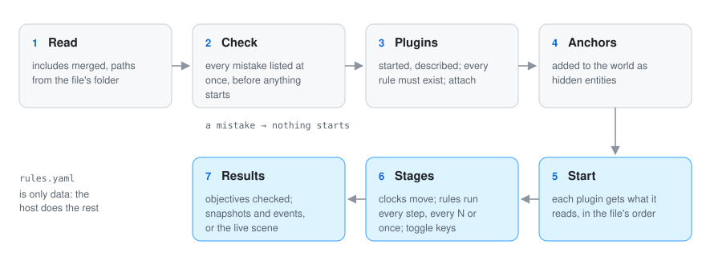

# 📜 Rules files

A rules file is the recipe of a simulation. In one readable YAML file you say which simulators
to use, what each one should do and with which numbers, how time passes, and what the result must
look like. You never write code to set up a simulation: you write a rules file.

A few things hold everywhere: relative paths start at the rules file's own folder, `~/` starts at
your home folder, and plugins are told where the rules file lives (`GO_SIMULATOR_RULES_DIRECTORY`)
so they find your files the same way.

<p align="center">
  
</p>

## A complete example

```yaml
scene_style: style.yaml                  # optional: draw batches with go-scene-builder's rules

anchors:                                 # places the story fixes
  - {id: main_gate, role: gate, at: [-2.5, 1.2], source: "chapter 3 of the story"}
  - {from: anchors.geojson, role: obstacle}

plugins:
  - name: terrain
    command: [go-simulator-terrain]      # program and arguments
  - name: urban
    command: [go, run, .]
    directory: ../go-simulator-urban     # where the program runs
  - name: motion
    builtin: true                        # a plugin the host program carries inside

stages:
  - name: town
    clock: {unit: year, from: 0, to: 100, step: 1, pace: 0.4}
    snapshots: [0, 50, 100]
    snapshot_fields: [elevation]
    rules:
      - rule: relief
        with: {path: relief.json, origin: [6, 4.5]}
      - rule: city
        name: my_town
        with: {include: town_scenario.yaml, seed: 8}
      - {rule: expand, with: {city: my_town}}
      - {rule: walls, with: {city: my_town}}
      - {rule: space_syntax, with: {city: my_town}, every: 5}
      - {rule: indicators, with: {city: my_town, years: [50, 100]}}
    objectives:
      - {name: walled by year 60, at: 60, count: {kind: wall}}
      - {name: about 6,000 people, at: 100, event: indicators, value: inhabitants, near: 6000, tolerance: 0.05}

  - name: weather
    clock: realtime
    rules:
      - {rule: day_cycle, with: {seconds_per_day: 120}, toggle_key: T}
      - {rule: gusts, enabled: false, toggle_key: G}
```

Read it top to bottom: two places are fixed (anchors), three plugins are started, and two stages
run side by side, a town growing a year at a time and the weather moving in real time.

## plugins

Each entry starts one simulator.

| Key | Meaning |
|---|---|
| `name` | How the rules refer to it (`plugin/rule` when several offer the same rule); unique |
| `command` | Program and arguments. A bare name is looked up in the `PATH`; a path with a folder starts at the rules file's folder |
| `directory` | Where the program runs (default: the rules file's folder) |
| `builtin` | `true` for a plugin compiled into the host program, found by name; no command |

The host starts every plugin, asks for its description (`describe`) and checks every rule exists.

## stages

A stage is a group of rules that share a clock. Several stages can run together on the same world.

| Key | Meaning |
|---|---|
| `name` | Unique |
| `clock` | `realtime`, or `{unit, from, to, step, pace}` (see below) |
| `rules` | The rules, run in this order |
| `snapshots` | Stage times at which a run without a window saves the world |
| `snapshot_fields` | Fields the snapshots save (default: every field); large fields take megabytes each |
| `objectives` | What the run must reach (see below) |

**Clocks.** `realtime` advances with the seconds shown, times the speed (`,` and `.` halve or
double it). A stepped clock goes from `from` to `to` by `step`; `unit` is only for people and
plugins to read. Without a window it runs as fast as it can; with a window it takes one step every
`pace` real seconds (0: only on request, for example with `-advance`). Steps happen before the
rules run, so the first step of `{from: -1, step: 1}` lands on year 0.

## rules

Each entry is one use of a rule a plugin offers. The same rule can be used several times, with
different names and numbers (two towns, say).

| Key | Meaning |
|---|---|
| `rule` | `name`, or `plugin/name` when several plugins offer it |
| `name` | Instance name (default `stage/rule`); rules that share state refer to each other by it |
| `with` | Parameters, as the plugin's reference describes them |
| `every` | Run when this much stage time passed since its last run (default: every step) |
| `at` | Run once, when the stage time reaches it |
| `enabled` | `false` to start switched off |
| `toggle_key` | A letter that switches it on and off in the viewer |

**Includes.** Long scenarios are easier to read in their own file, with comments. `with: {include: file.yaml}` (or a list of files) reads their YAML maps in order;
later files replace earlier keys and the rule's own keys win over all of them. A scenario can then
live in its own file, with comments and notes for people (plugins ignore keys they do not know).
An included file cannot include others, and paths inside it still start at the rules file's folder.

## anchors

Sometimes the story says "the gate is here" or "the old oak stands on this hill". Anchors are how
you tell the simulators: they are places the story fixes. The host adds them to the world before the simulation starts, as hidden
entities with `anchor: true`, their `role` and their `source`; plugins build around them, never
over them, and can use them in habitats or regions.

| Key | Meaning |
|---|---|
| `id` | Identifier (needed unless `from`) |
| `kind` | Default `anchor` |
| `role` | What it means to the plugins: `gate`, `obstacle`, `road`, `plant`, `region`… |
| `at` / `line` (+ `width`) / `outline` | A point, a line or a polygon in ground coordinates (exactly one of these or `from`) |
| `from` | A GeoJSON file: one anchor per point, line string or polygon; the feature's `id`, `kind`, `role`, `width` and `source` win |
| `properties` | Free data, for example `{species: old_oak, crown: 20}` for the flora |
| `source` | Where it comes from, for people |

## objectives

Objectives are the result you expect, written down: "the town has a wall by year 60", "about
6,000 people at the end". They turn "it looks about right" into something checked every run. Runs without a window check each objective when its stage reaches its time,
print it, save every result in `objectives.json` and fail if any was missed (`-objectives warn`
only reports them). An objective whose time falls outside its stage's clock counts as missed.

| Key | Meaning |
|---|---|
| `name` | For people |
| `at` | Stage time at which it is checked |
| `count` | A [condition](vocabulary.md#conditions) over entities: it counts those that match |
| `event` + `value` | Reads a number from the data of the last event of that name |
| `min`, `max` | Bounds |
| `near` + `tolerance` | Within a share of a value (0.05 = ±5 %) |
| `source` | Where it comes from, for people |

Give either `count` or `event`. A count with no bounds asks for at least one.

## scene_style

Plugins publish data, not looks: a building is an outline, a height and some properties. A
[go-scene-builder](https://github.com/akrck02/go-scene-builder) style file. With it, the viewer draws the batches its
rules match with the scene builder (roofs, gates, facades, bridges) instead of plain extruded
outlines; the other batches are drawn as before. The builder needs GEOS to compile.

## Checking

Mistakes are caught before anything starts, all at once, so you do not wait for a long run to fail
on a typo. The host refuses a rules file with mistakes before it starts anything: missing names, duplicated
plugins or stages, stepped clocks without a positive step, negative `every`, anchors without a
shape, objectives without bounds, malformed conditions. Every problem is listed at once.
