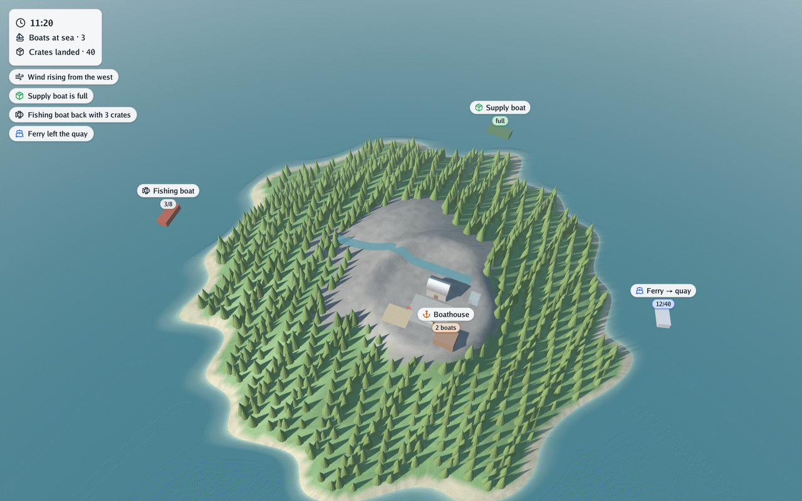

# ▶️ Running

There are two ways to run a simulation. **Without a window**, it runs as fast as it can and writes
files: snapshots to draw maps from, every event, and whether the objectives were met. **Live**, it
opens the 3D scene and you watch the simulation happen, with keys to pause, speed up or switch
rules on and off.

## Without a window: simulate

```bash
go run ./cmd/simulate -rules rules.yaml -output results/
go run ./cmd/simulate -rules rules.yaml -scene scene.glb -output results/ -objectives warn
```

It runs the stepped stages, one step each in turn, to the end of their clocks; real-time stages
do not run. `-scene` starts the world from a glTF scene (its nodes become entities).
`-objectives fail` (default) makes a missed objective an error; `warn` only reports it.

It writes, in the output folder:

| File | Content |
|---|---|
| `<stage> <time>.geojson` | Every entity with a ground shape (polygons, line strings, points at their position), with its id, kind, parent and properties, and the shape's height and width; coordinates `[x, z]` |
| `<stage> <time> <field>.json` + `.f32` | Every field (or the stage's `snapshot_fields`) as a grid: a JSON header (`columns`, `rows`, `cell`, `extent`, `west`, `north`, `axes: east-south`) and little-endian float32 values, row by row; the relief format of go-scene-builder |
| `events.jsonl` | Every event, one JSON per line, with its origin, stage and time |
| `objectives.json` | Every objective: when it was checked, the value found, whether it was reached and what was expected |

Snapshots are taken at the times each stage lists in `snapshots`, after the step that reaches
them.

## Live: simulator

```bash
go run ./cmd/simulator -rules rules.yaml scene.glb
go run ./cmd/simulator -rules rules.yaml -advance 80 -capture frame.png scene.glb
```

It opens the scene with go-renderer's viewer and runs the plugins on it. It takes every viewer
option (`-walk`, `-night`, `-look-at`, `-capture`, `-benchmark`…; see
[go-renderer's viewer](https://github.com/akrck02/go-renderer/blob/feature/escenas-3d/docs/viewer.md)) and:

| Option | Effect |
|---|---|
| `-rules file` | The rules file (without it, the scene is only shown) |
| `-advance N` | Steps every stepped stage N times before showing, to start or capture further on |

| Key | Action |
|---|---|
| `P` | Pause and resume |
| `,` `.` | Halve or double the speed of time |
| a rule's `toggle_key` | Switch that rule on and off |

### What the viewer shows

<p align="center">
<picture>
  <source media="(prefers-color-scheme: dark)" srcset="images/hero-dark.png">
  
</picture>
</p>

Besides the scene, the viewer writes a few words over it, from the
[overlay properties](vocabulary.md#shared-names) of the entities: **labels** above them, a
**header** in the top-left corner and **notices** under it. Captures (`-capture`) include them.
See [labels, header and notices](overlay.md).

### The bridge

The bridge is the translator between the neutral world and the 3D scene. It builds the initial world from the scene (every node becomes an entity, with its glTF
extras as properties, and the scene's environment comes along) and turns every change set into
scene changes:

- ground shapes become meshes draped on the terrain (the scene's walkable ground), batched by
  `batch`; flat ones float `lift` over the ground and are pulled towards the camera;
- with a `scene_style`, the batches its rules match are built by go-scene-builder, with roofs,
  facades, gates and instanced models;
- `clear_area` removes the triangles of the named nodes whose middle falls inside the outlines,
  and the instances standing there, sparing the holes;
- the environment moves the sun, wind, clouds, tide, snow line and foliage tint;
- the overlay properties become labels and header lines, and events with a `notice` become
  notices (see [labels, header and notices](overlay.md)).

## Known limits

What the bridge does not do yet is listed in the documentation index, under
[not done yet](README.md#-not-done-yet).
